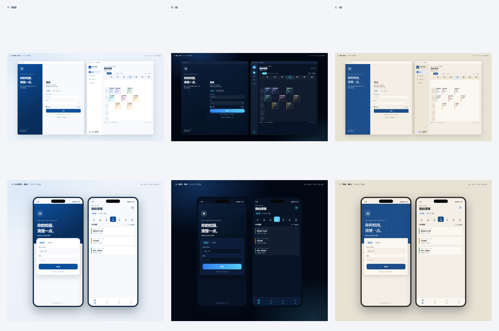

# M0 设计概念

三套 Win + Android 统一概念稿，均覆盖登录与课表两个核心画面。选择一套后再收敛为 Flutter 设计令牌与组件。

| 方向 | 关键词 | 适合的气质 | 风险 |
| --- | --- | --- | --- |
| A · 静蓝 | 校识蓝、白、浅灰 | 稳重、可信、像学校自己的产品 | 相对保守，品牌记忆点较弱 |
| B · 流光 | 深色、玻璃、青色高光 | 年轻、有科技感、夜间使用舒适 | 长时间阅读表格的对比度与功耗需额外打磨 |
| C · 纸感 | 暖米色、衬线标题、细网格 | 安静、有编辑感、区别于常见校园 App | 离“校园工具”略远，信息密度低时容易显得空 |

**建议**：A 作为主方向最稳，后续用图标、留白和课表色块建立记忆点；如果希望更有个性，可以在 A 的骨架上局部借用 B 的深色仪表盘或 C 的纸张纹理，而不是直接混合三套。

## 文件

- `render.html`：可交互的 HTML/CSS 源稿；参数 `?concept=a|b|c&platform=desktop|mobile`
- `png/a-desktop.png`、`png/a-mobile.png`
- `png/b-desktop.png`、`png/b-mobile.png`
- `png/c-desktop.png`、`png/c-mobile.png`
- `overview.png`：三套 × 双端的联络表

## 选择方式

回复 `A`、`B` 或 `C`，并说明想保留/替换的细节即可。选定后进入 M1，先做登录与持久会话，再把方向落为 Flutter 主题与组件。
